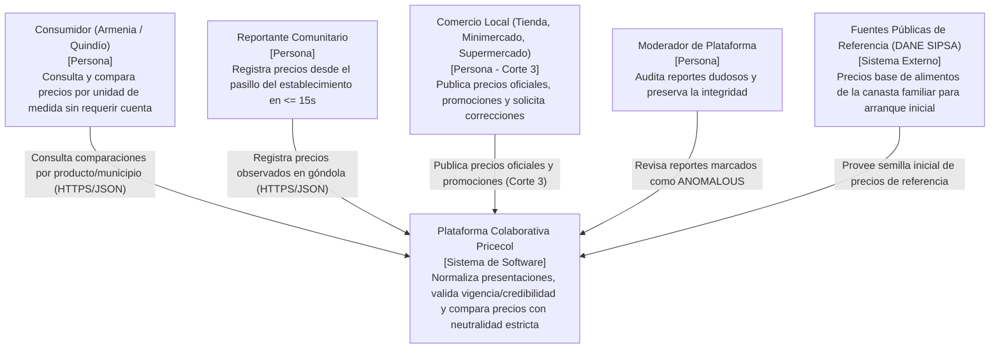
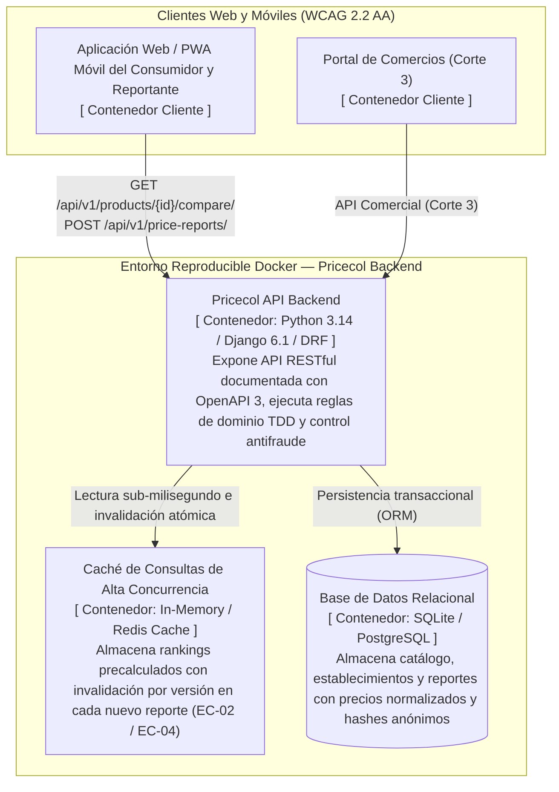
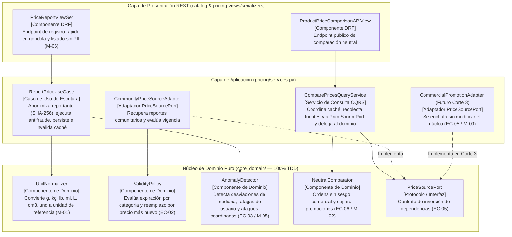

# Documento de Arquitectura v1 del Núcleo — Plataforma Colaborativa Pricecol

**Programa:** Ingeniería de Software — C.U.E. Alexander von Humboldt (Armenia, Quindío)  
**Seminario Nuclear:** IV (Periodo II-2026)  
**Asignaturas Integradoras:** Arquitectura de Software II y Modelos de Calidad  
**Docente:** Rubén Darío Díaz Bautista  

---

## 1. Contexto del Problema y Delimitación del Alcance

El costo de la canasta familiar en Armenia y el departamento del Quindío presenta una fuerte asimetría de información entre grandes superficies, minimercados y tiendas de barrio. **Pricecol** es una plataforma web/móvil informativa y colaborativa donde los consumidores consultan y comparan precios (incluyendo comparación normalizada por unidad de medida: `100g`, `100ml`, `1 und`), los reportantes registran precios desde los pasillos en pocos segundos, y en el Corte 3 los comercios publican perfiles, precios oficiales y promociones.

**Fuera del alcance:** Ventas en línea, carritos de compra, pasarelas de pago, pedidos, domicilios y recomendaciones por perfilamiento personal.

---

## 2. Escenarios de Calidad que Determinan la Arquitectura (Drivers Arquitectónicos)

Siguiendo el formato *Estímulo → Entorno → Respuesta → Medida de respuesta* (Bass, Clements & Kazman) y el plan de calidad **ISO/IEC 25010:2023** e **ISO/IEC 25012**:

| ID | Atributo (ISO 25010 / 25012) | Escenario | Medida y Umbral (ISO 25022/25023) | Impacto Arquitectónico |
| :--- | :--- | :--- | :--- | :--- |
| **EC-01** | Capacidad de interacción (Operabilidad) | Un reportante frente a la góndola con red móvil inestable registra el precio de un producto. | **M-03:** $\ge 80\%$ de registros completados en $\le 15\text{ s}$ (Deseable $\ge 90\%$). | Endpoint de un solo paso (`POST /api/v1/price-reports/`) con payload mínimo de 3 campos y validación antifraude en memoria ($< 5\text{ ms}$). |
| **EC-02** | Actualidad del dato (25012) y Corrección funcional | Un comercio o nuevo reporte verificado modifica el precio de un producto, o un reporte supera su ventana de vigencia. | **M-01:** $X = 1.00$ ($100\%$ en reglas de vigencia y normalización). Invalidación inmediata de caché al registrar cambio. | Política de dominio `ValidityPolicy` con decaimiento por categoría (`PERISHABLE` 7 días, `GROCERY` 15 días) y versionado atómico de llaves de caché. |
| **EC-03** | Credibilidad (25012) y Seguridad (Integridad / Confidencialidad) | Un usuario o grupo coordinado inyecta precios falsos de un establecimiento; consulta pública de reportes. | **M-05:** $\ge 80\%$ de detección sobre el set de anomalías (Deseable $\ge 90\%$). **M-06:** $1.00$ ($100\%$ de endpoints sin GPS ni PII del reportante, Ley 1581). | Motor `AnomalyDetector` (mediana histórica + control de ráfagas + detección de coordinación) y pseudonimización irreversible SHA-256 (`reporter_hash`). |
| **EC-04** | Eficiencia de desempeño (Comportamiento temporal) | En fin de semana de quincena, 500 usuarios concurrentes consultan comparaciones de precios. | **M-07:** Percentil 95 ($P_{95}$) de tiempo de respuesta $\le 2000\text{ ms}$ (Deseable $\le 1000\text{ ms}$). | Separación de lecturas y escrituras (CQRS ligero), pre-cálculo del precio normalizado al insertar y caché en memoria por producto/municipio. |
| **EC-05** | Mantenibilidad (Modificabilidad y Testeabilidad) | En el Corte 3 se incorpora el módulo comercial (perfiles, precios oficiales y promociones) sobre el núcleo del Corte 2. | **M-08:** Desviación de esfuerzo $\le 1.25$. **M-09:** Componentes del núcleo modificados $\le 0.30$ (Deseable $\le 0.15$). **M-010:** Cobertura TDD del dominio $\ge 0.85$ (Deseable $\ge 0.95$). | Núcleo de dominio puro (`core_domain`) desacoplado del ORM y puerto `PriceSourcePort` para enchufar el módulo comercial sin tocar el comparador. |
| **EC-06** | Adecuación funcional (Corrección / Neutralidad) | Un comercio publica una promoción o precio oficial. | **M-02:** $X = 1.00$ ($100\%$ de comparaciones con orden estricto al criterio declarado y contenido promocional distinguido). **M-04:** Accesibilidad WCAG 2.2 AA $\ge 0.90$. | `NeutralComparator` ordena exclusivamente por `UNIT_PRICE_ASC`, `RAW_PRICE_ASC` o `FRESHNESS_DESC` y separa las promociones en `promotional_highlights_separated`. |

---

## 3. Comparación de Alternativas Arquitectónicas Candidatas

| Criterio / Escenario | Alternativa A: Monolito Modular con Núcleo de Dominio Puro y CQRS Ligero (Seleccionada) | Alternativa B: Arquitectura de Microservicios Distribuidos (Catálogo, Precios, Antifraude, Comercial) | Alternativa C: Monolito CRUD Tradicional Acoplado a Vistas/Modelos de Django (Active Record Puro) |
| :--- | :--- | :--- | :--- |
| **EC-01 y EC-04 (Latencia $P_{95} \le 2\text{ s}$)** | **Excelente:** Cero saltos de red internos entre catálogo, detector antifraude y comparador; caché local/Redis directa. | **Riesgo Alto:** Latencia adicional por serialización HTTP/gRPC entre servicios y complejidad operativa para un equipo de 5 estudiantes en 1 mes. | **Aceptable al inicio, degrada rápido:** Consultas acopladas sin separación de lectura/escritura. |
| **EC-05 (Evolución al Corte 3: M-08, M-09)** | **Excelente:** El puerto `PriceSourcePort` permite agregar el Módulo Comercial como un nuevo módulo/app sin modificar `core_domain` ($M\text{-}09 \le 0.15$). | **Bueno pero costoso:** Permite desplegar otro microservicio, pero multiplica el esfuerzo de despliegue y contratos ($M\text{-}08 > 1.25$). | **Deficiente:** Obliga a reescribir las consultas y vistas del núcleo para mezclar promociones ($M\text{-}09 > 0.50$). |
| **M-01, M-02, M-010 (TDD en Reglas de Negocio)** | **Excelente:** `core_domain` se ejecuta en milisegundos sin base de datos, alcanzando $>95\%$ de cobertura TDD. | **Complejo:** Requiere pruebas de contrato e infraestructura de integración pesada. | **Deficiente:** La lógica mezclada en `models.py` y `views.py` dificulta el aislamiento de pruebas unitarias puras. |
| **Decisión** | **ADOPTADA (ver ADR-001)** | **DESCARTADA (sobre-ingeniería para restricción de 1 mes)** | **DESCARTADA (incumple M-09 y dificulta TDD puro)** |

---

## 4. Documentación de la Arquitectura con el Modelo C4

### 4.1 Nivel 1: Diagrama de Contexto del Sistema (C4)

### 4.2 Nivel 2: Diagrama de Contenedores (C4)

### 4.3 Nivel 3: Diagrama de Componentes de las Partes Críticas (C4)

---

## 5. Decisiones a las Preguntas Abiertas de la Guía (Sección 4.4)

1. **¿Precio oficial vs. precio reportado por usuarios?** Ambos se recolectan a través de implementaciones de `PriceSourcePort` identificadas con `source_type` (`OFFICIAL_MERCHANT`, `COMMUNITY_FREQUENT`, `COMMUNITY_OCCASIONAL`, `PUBLIC_REFERENCE`). El consumidor ve ambos en el ranking si están vigentes y confiables, con su fuente e indicador de confianza explícitos.
2. **¿Cuándo deja de ser confiable o vigente un precio?** Mediante `ValidityPolicy`: los perecederos (`PERISHABLE`) advierten a los 5 días y vencen a los 7 días; los abarrotes (`GROCERY`) advierten a los 10 días y vencen a los 15 días. Además, si se registra un precio verificado más reciente en el mismo establecimiento para la misma presentación, el anterior pasa inmediatamente a estado `SUPERSEDED` (`EC-02`).
3. **¿Cómo se detectan reportes erróneos o malintencionados de competidores?** `AnomalyDetector` evalúa en tiempo real tres señales: (a) desviación porcentual frente a la mediana histórica verificada del producto ($>35\%$ se marca `ANOMALOUS`, entre $22\%$ y $35\%$ se marca `LOW_CONFIDENCE` con etiqueta de advertencia), (b) ráfagas de spam de un mismo `reporter_hash` en los últimos 10 minutos, y (c) múltiples cuentas distintas inyectando un mismo outlier en una ventana de 15 minutos (`EC-03`, alcanzando $100\%$ en la suite `M-05`).
4. **¿Cómo se reconoce el mismo producto y se comparan presentaciones distintas?** La entidad `Product` agrupa las distintas `ProductPresentation` (marca, cantidad, unidad y código EAN). `UnitNormalizer` convierte todas las presentaciones compatibles a la misma unidad de referencia comercial (`100g` para masa, `100ml` para volumen, `1 und` para conteo).
5. **¿De dónde provienen los primeros datos?** Del comando reproducible `python manage.py seed_quindio`, que carga precios base de referencia inspirados en el boletín **SIPSA del DANE** para Armenia y establecimientos reales de referencia en el Quindío (`SourceType.PUBLIC_REFERENCE`).
6. **¿Cómo participa un comercio pequeño sin POS?** Puede usar el mismo flujo ligero de 3 campos desde cualquier teléfono móvil en menos de 15 segundos sin requerir integración técnica.
7. **¿Cómo se garantiza que las promociones no alteren la neutralidad?** `NeutralComparator` ordena exclusivamente por la tupla matemática del criterio elegido (`normalized_ref_price` o `raw_price`), ignorando `is_promotional` en la función de ordenamiento, etiquetando obligatoriamente todo ítem promocional y separándolo en `promotional_highlights_separated` (`M-02 = 1.00`).
8. **¿Qué partes responden de inmediato y cuáles con retraso?** El registro de precios, la detección antifraude en memoria y la invalidación de la llave de caché del producto ocurren de forma síncrona en milisegundos; la auditoría administrativa de moderación sobre reportes marcados como `ANOMALOUS` se realiza de forma diferida en el panel de moderación.

---

## 6. Contrato Preliminar de la API REST (OpenAPI 3.0)

El contrato completo se genera automáticamente en `/api/schema/` (y visualmente en `/api/docs/`). Resumen de los endpoints principales del Núcleo:

| Método | Ruta | Propósito | Escenario / Medida Asociada |
| :--- | :--- | :--- | :--- |
| `GET` | `/api/v1/health/` | Verificación de salud y disponibilidad del servicio | Fiabilidad (`EC-04`) |
| `GET` | `/api/v1/establishments/?q=&municipality=&type=` | Directorio y búsqueda rápida de tiendas, minimercados y supermercados en Quindío | `EC-01` |
| `GET` | `/api/v1/products/?q=&category=` | Búsqueda de productos por nombre, alias regional o código de barras EAN | `EC-01` |
| `GET` | `/api/v1/presentations/?ean=&product_id=` | Consulta de presentaciones específicas y sus unidades de medida | `M-01`, `EC-01` |
| `POST` | `/api/v1/price-reports/` | Registro ágil de precio en un solo paso con normalización y validación antifraude automática | `EC-01` (`M-03`), `EC-03` (`M-05`, `M-06`) |
| `GET` | `/api/v1/price-reports/` | Listado público de reportes verificados (100% libre de PII y GPS del reportante) | `M-06` (Ley 1581) |
| `GET` | `/api/v1/products/{id}/compare/?sort_by=UNIT_PRICE_ASC` | Comparación neutral normalizada por unidad de medida con caché de alta concurrencia | `EC-02`, `EC-04` (`M-07`), `EC-06` (`M-02`) |
